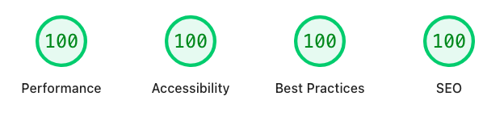

# Memory Game

[](https://olgagulyakevich.github.io/memory-game/)
[](https://react.dev/)
[](https://webpack.js.org/)
[](https://www.i18next.com/)
[](#quality--engineering)
[](#license)

**A multilingual memory card game — tactile 3D card flips, three themed decks, and a 115 KB bundle that still scores PageSpeed 100.**

https://github.com/user-attachments/assets/040afd26-1f54-46b3-ae41-520d11f48d38

## Live Demo

**[Play the game](https://olgagulyakevich.github.io/memory-game/)** — pick a deck, flip cards, beat your own step count.

---

## Motion & Interaction Craft

The whole game *is* an interaction, so the motion has one job: make a flip feel like turning a real card.

- **3D card flip** — `rotateY` on a preserved-3d container with a backface-hidden face, so the card turns rather than cross-fades. GPU-only (`transform`), no layout or paint per frame.
- **Mismatch feedback** — a wrong pair stays visible long enough to be memorised, then turns back; the delay is the game mechanic, not a decoration.
- **Reduced motion respected** — animations are gated behind `prefers-reduced-motion`, so a player who asks the OS for less movement still gets the full game, just without the spin.

---

## Tech Stack

| Category | Tools |
| --- | --- |
| **Framework** | React 19 (hooks) · React Router 7 |
| **Bundler** | Webpack 5 — hand-configured (code splitting, vendor chunks, asset pipeline) |
| **i18n** | i18next · react-i18next — EN / FR / RU with persisted preference |
| **Styles** | CSS3 with custom properties, mobile-first |
| **Deployment** | GitHub Pages (`gh-pages`) with SPA 404 fallback |

No UI kit and no animation library — the board, the cards and the flip are hand-built.

---

## Quality & Engineering

- **PageSpeed Insights 100 · 100 · 100 · 100** — performance, accessibility, best practices and SEO, measured on the live build.

<p align="center"></p>

- **115 KB gzipped total**, split into vendor / router / app chunks rather than one blob.
- **Hand-configured Webpack** — the split above is a deliberate config, not a framework default.
- **`React.memo` on the card** — a board of 16+ cards re-renders only what changed on each flip.
- **Images optimised** to WebP with fallbacks.

</div>

<details>
<summary>Bundle composition</summary>

```text
react-vendor.js        51.39 KB  (44.5%)
main.js                29.42 KB  (25.5%)
vendors.js             16.64 KB  (14.4%)
router-vendor.js       11.53 KB  (10.0%)
react-vendor-2.js       5.30 KB   (4.6%)
runtime.js              0.96 KB   (0.8%)
```

Total gzipped: **115.44 KB**

</details>

> Quality here is verified by **documented manual QA** — cross-browser passes and a WCAG AA audit — not by an automated suite. Automated tests are on the roadmap.

---

## Accessibility

- **WCAG AA** contrast across all three decks.
- **Fully keyboard-playable** — every card is reachable and flippable without a mouse.
- **ARIA labelling** on cards, board, header and the language switcher, so a screen-reader player knows what is face-up, what is matched and how many steps they've taken.
- **Semantic structure** — landmarks and headings, not a soup of divs.
- **`prefers-reduced-motion`** honoured throughout.

---

## Project Structure

```text
src/
├── components/
│   ├── pages/        # StartScreen · GameScreen · ResultScreen
│   └── ui/           # Card · GameBoard · GameHeader · GameModal · Navigation · LanguageSwitcher
├── hooks/            # useGame — all game logic in one place
├── utils/            # helpers, i18n setup, path handling, pluralisation, settings
├── data/             # deck definitions
└── styles/           # global CSS with design tokens
```

The game's rules live entirely in **`useGame`** — the components render state and report clicks, nothing more. That separation is what keeps the screens small and the logic testable.

---

## Getting Started

```bash
npm install
npm start        # dev server, opens automatically
npm run build    # production build → dist/
```

## Commands

| Command | What it does |
| --- | --- |
| `npm start` | dev server with hot reload |
| `npm run build` | production build |
| `npm run deploy` | build + publish to the `gh-pages` branch |
| `npm run serve` | serve the built `dist/` locally |
| `npm run analyze` | bundle analyzer — the source of the numbers above |

---

## License

MIT

## Author

<a href="https://github.com/OlgaGulyakevich"></a>

**Olga Gulyakevich** — Frontend Developer

[](https://github.com/OlgaGulyakevich)
[](https://www.linkedin.com/in/olga-gulyakevich-ab166674/)

<br clear="left"/>
